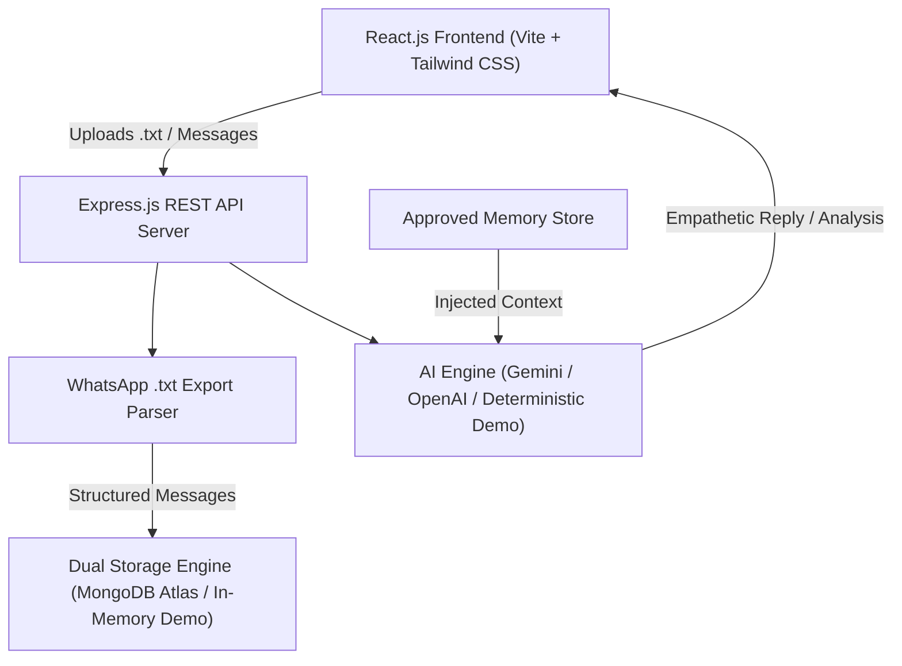

# AI Relationship Companion 💖🤖

A private, full-stack web application designed for empathetic communication reflection, WhatsApp chat export analysis, and natural conversational practice in **Hinglish** and **English**.

The companion is an **artificial intelligence assistant**, not a human partner or a clinical psychologist. It provides a safe, reflective space to understand communication patterns, practice empathy, and maintain user-controlled conversational preferences.

---

## 🌟 Key Features

1. **WhatsApp Chat Import (.txt)**
   - Drag-and-drop parser supporting standard WhatsApp `"Export chat without media"` exports.
   - Handles Android & iOS formats, 12h/24h timestamps, multiline messages, colons in text, and Unicode markers (`\u200e`, `\u202f`, BOM).
   - Filters system notices (encryption, deleted messages, media omitted).
   - Participant identification and custom role mapping (e.g. "Me", "Partner").
   - 1-click **Synthetic Sample Chat** (Priya & Deepak) for immediate zero-setup testing.

2. **Emotion & Conversational Analysis**
   - Structured JSON emotion labeling: `Happy`, `Sad`, `Frustrated`, `Worried`, `Affectionate`, `Neutral`, `Mixed`, `Unclear`.
   - Confidence estimate score with explicit disclaimer that it is a computational estimate, not human mind-reading.
   - Categorizes conversation topics (`#CareerMilestones`, `#QualityTime`, `#WorkStress`).
   - Identifies communication preferences explicitly supported by message text.
   - Generates empathetic response suggestions with a 1-click "Practice in Companion Chat" action.

3. **Interactive AI Companion Chat**
   - Natural, conversational responses in **Hinglish**, **English**, or **Hindi**.
   - Adjustable tone: **Warm**, **Friendly**, **Calm**, **Supportive**.
   - Quick prompt pills for fast reflection prompts.
   - Keyboard shortcuts: `Enter` sends; `Shift+Enter` inserts a new line.
   - One-click copy, response retry, and conversation history clearing.
   - Context-aware responses using recent dialogue and approved user memories.

4. **User-Controlled Memory System**
   - Logically separate from raw imported messages.
   - Only user-approved communication preferences and topics are remembered.
   - Deduplication and character limits (max 250 chars per memory).
   - Full CRUD control: view, edit, toggle active status, delete individual, or clear all.

5. **Security, Privacy & Ethics First**
   - Clear AI identification: never impersonates Deepak or pretends to be a real human partner.
   - No secret WhatsApp automation or background scraping.
   - Prompt injection defense: historical messages are treated strictly as quoted data.
   - Server-side secret isolation: API keys are never leaked to client bundles.
   - One-click data export (JSON backup) and permanent data wipe.
   - Local **In-Memory Demo Mode** fallback when MongoDB or API keys are not configured.

---

## 🏗️ Architecture Overview



---

## 📂 Project Directory Structure

```text
ai-relationship-companion/
├── client/                     # Frontend Application
│   ├── public/
│   │   └── favicon.svg         # SVG App Logo
│   ├── src/
│   │   ├── components/         # Reusable UI Components
│   │   │   ├── Alert.jsx       # Alert banners
│   │   │   ├── Badge.jsx       # Emotion and status pills
│   │   │   ├── Button.jsx      # Button variants and loaders
│   │   │   ├── Card.jsx        # Glassmorphic containers
│   │   │   ├── Footer.jsx      # Safety manifesto & links
│   │   │   ├── Modal.jsx       # Accessible modal dialogs
│   │   │   └── Navbar.jsx      # Sticky top navigation
│   │   ├── hooks/
│   │   │   └── useAuth.jsx     # Authentication and guest session hook
│   │   ├── pages/              # 8 Application Pages
│   │   │   ├── LandingPage.jsx         # Welcome & hero section
│   │   │   ├── DashboardPage.jsx       # Real metrics & chat lists
│   │   │   ├── ImportChatPage.jsx      # Drag-and-drop parser & preview
│   │   │   ├── AnalysisPage.jsx        # Emotion & tone dashboard
│   │   │   ├── CompanionChatPage.jsx   # Interactive Hinglish AI chat
│   │   │   ├── MemoryManagerPage.jsx   # Approved memory manager
│   │   │   ├── SettingsPage.jsx        # Privacy, export, & data wipe
│   │   │   └── NotFoundPage.jsx        # 404 error page
│   │   ├── services/
│   │   │   └── api.js          # REST API client with JWT handling
│   │   ├── styles/
│   │   │   └── index.css       # Tailwind & glassmorphism theme
│   │   ├── App.jsx             # React Router setup
│   │   └── main.jsx            # React root mount
│   ├── package.json
│   ├── vite.config.js          # Vite config with API reverse proxy
│   └── tailwind.config.js      # Dark navy and neon gradient colors
├── server/                     # Backend Application
│   ├── src/
│   │   ├── config/
│   │   │   ├── db.js           # MongoDB connection with in-memory fallback
│   │   │   └── env.js          # Environment variables validator
│   │   ├── controllers/
│   │   │   ├── authController.js
│   │   │   ├── chatController.js
│   │   │   ├── companionController.js
│   │   │   ├── memoryController.js
│   │   │   └── settingsController.js
│   │   ├── middleware/
│   │   │   ├── authMiddleware.js
│   │   │   ├── errorHandler.js
│   │   │   ├── rateLimiter.js
│   │   │   └── validateRequest.js
│   │   ├── models/             # Mongoose Schemas
│   │   │   ├── User.js
│   │   │   ├── ImportedConversation.js
│   │   │   ├── CompanionSession.js
│   │   │   └── CompanionMemory.js
│   │   ├── routes/             # REST Endpoints
│   │   │   ├── authRoutes.js
│   │   │   ├── chatRoutes.js
│   │   │   ├── companionRoutes.js
│   │   │   ├── healthRoutes.js
│   │   │   ├── memoryRoutes.js
│   │   │   └── settingsRoutes.js
│   │   ├── services/
│   │   │   ├── aiService.js         # Emotion analysis & Hinglish chat
│   │   │   ├── storageService.js    # Dual MongoDB & Demo repository
│   │   │   └── whatsappParser.js    # Multi-format WhatsApp parser
│   │   ├── utils/
│   │   │   └── sampleChats.js       # Synthetic Priya & Deepak chat
│   │   ├── app.js              # Express app setup
│   │   └── server.js           # Server listen & lifecycle
│   ├── tests/
│   │   ├── whatsappParser.test.js   # 9 parser unit tests
│   │   ├── aiService.test.js        # 4 AI service unit tests
│   │   └── api.test.js              # 14 REST integration tests
│   ├── package.json
│   └── .env.example
├── shared/
│   └── constants.js            # Shared emotions, tones, and disclaimers
├── docker-compose.yml
├── Dockerfile
├── vercel.json                 # Vercel SPA configuration
├── render.yaml                 # Render deployment blueprint
├── package.json                # Root development scripts
└── README.md
```

---

## ⚡ Quick Start (Windows PowerShell)

### Prerequisites
- **Node.js**: v18.0.0 or higher (v20+ recommended)
- **npm**: v9.0.0 or higher

### 1. Clone or Open the Workspace
```powershell
cd d:\ai-relationship-comanion
```

### 2. Install Dependencies
```powershell
# Install server dependencies
cd server
npm install

# Install client dependencies
cd ..\client
npm install

cd ..
```

### 3. Run the Automated Test Suite
```powershell
cd server
npm test
cd ..
```
*Expected: 27/27 tests pass (WhatsApp Parser, AI Engine, and REST API integration).*

### 4. Start Development Mode
You can launch both server and client with one command:
```powershell
# In terminal 1 (Backend Server on http://localhost:5000):
npm --prefix server run dev

# In terminal 2 (Frontend Client on http://localhost:5173):
npm --prefix client run dev
```

Visit **`http://localhost:5173`** in your browser!

---

## ⚙️ Environment Configuration

### Backend (`server/.env`)
Create `server/.env` based on `server/.env.example`:

```env
# Server
PORT=5000
NODE_ENV=development
CLIENT_URL=http://localhost:5173

# Security
JWT_SECRET=your_jwt_secret_key_change_in_production_min_32_chars
JWT_EXPIRES_IN=7d

# Database
# Leave blank or set to 'demo' to run in zero-config In-Memory Demo Mode!
MONGODB_URI=

# AI Provider
# Options: 'demo' (deterministic fallback), 'gemini', 'openai'
AI_PROVIDER=demo
AI_MODEL=demo-relationship-v1

# Optional External API Keys (Leave blank for Demo Mode)
GEMINI_API_KEY=
OPENAI_API_KEY=

# Guardrails
REQUIRE_EXTERNAL_AI_CONSENT=true
MAX_UPLOAD_SIZE_MB=5
MAX_CONTEXT_MESSAGES=15
DATA_RETENTION_DAYS=30
```

### Frontend (`client/.env`)
In local development, the Vite proxy directs `/api` calls to `http://localhost:5000`. In production:
```env
VITE_API_URL=https://your-backend-app.onrender.com/api
```

---

## 🧪 Testing Results

Our test suite runs with Node's native test runner (`node:test`) and Supertest:

- **WhatsApp Chat Parser Suite (9 tests)**:
  - Android 24-hour exports (`12/05/2023, 14:30 - Name: Msg`)
  - 12-hour AM/PM exports (`5/12/23, 9:15 AM - Name: Msg`)
  - iOS bracketed formats (`[12/05/2023, 14:30:15] Name: Msg`)
  - Multiline messages continuation
  - URLs and multiple colons in message body
  - System encryption notices and deleted message detection
  - Invisible Unicode markers stripping (`\u200e`, `\u202f`, BOM)
  - Rejection of empty or non-WhatsApp text files
- **AI Emotion & Companion Service Suite (4 tests)**:
  - Structured JSON emotion extraction across 8 valid labels
  - Warm Hinglish companion responses with explicit AI self-identification
  - Approved memory injection into dialogue
  - Hinglish, Hindi, and English language switching
- **REST API Integration Suite (14 tests)**:
  - `GET /api/health` system diagnostic check
  - `POST /api/auth/guest` zero-config session generation
  - Unauthorized request rejection (401)
  - File upload validation and rejection of empty files (400)
  - 1-click synthetic chat upload and parsing (201)
  - Conversation retrieval, analysis, and deletion
  - Companion messaging and session history
  - Memory creation, deduplication, update, and deletion

---

## 🚀 Production Deployment Guide

### 1. MongoDB Atlas Setup
1. Create a free cluster on [MongoDB Atlas](https://www.mongodb.com/cloud/atlas).
2. Under **Network Access**, add `0.0.0.0/0` (allow connections from your hosting provider).
3. Under **Database Access**, create a user with read/write privileges.
4. Copy the connection string (e.g. `mongodb+srv://<user>:<password>@cluster0.mongodb.net/ai-relationship-companion?retryWrites=true&w=majority`).

### 2. Backend Deployment on Render
1. Push your repository to GitHub.
2. In [Render](https://render.com), choose **New → Web Service**.
3. Select your repository and specify:
   - **Root Directory**: `server`
   - **Build Command**: `npm install`
   - **Start Command**: `npm start`
   - **Health Check Path**: `/api/health`
4. Under **Environment Variables**, set:
   - `NODE_ENV`: `production`
   - `PORT`: `5000`
   - `JWT_SECRET`: *(Generate a strong 32-character string)*
   - `MONGODB_URI`: *(Your MongoDB Atlas connection URI)*
   - `CLIENT_URL`: *(Your Vercel frontend URL, e.g. `https://my-companion.vercel.app`)*
   - `AI_PROVIDER`: `demo` *(or `gemini` if you supply `GEMINI_API_KEY`)*

### 3. Frontend Deployment on Vercel
1. In [Vercel](https://vercel.com), select **Add New Project** and pick your repository.
2. Set **Root Directory** to `client`.
3. Build & Output Settings:
   - **Framework Preset**: Vite
   - **Build Command**: `npm run build`
   - **Output Directory**: `dist`
4. Under **Environment Variables**, add:
   - `VITE_API_URL`: `https://your-render-service.onrender.com/api`
5. Click **Deploy**. Vercel will build and host your frontend with client-side SPA routing (`vercel.json`).

### 4. Docker Deployment (Optional)
To run the full stack locally with Docker Compose:
```bash
docker-compose up --build
```
This launches both the Node application on port 5000 and a local MongoDB 7.0 container.

---

## 🛡️ AI Ethics & Boundaries

- **Never Impersonates Real Humans**: The companion explicitly declares itself as an AI system in every session. It never impersonates Deepak or any other individual in your chat history.
- **No Mental Health Diagnoses**: Tone and emotion labels are statistical approximations of written text. They do not represent medical assessments.
- **No Guilt or Emotional Dependency**: The companion will never guilt-trip you, encourage isolation from real human relationships, or manufacture unhealthy dependency.
- **Data Sovereignty**: You can export your data as JSON or wipe all stored records at any moment from the Settings page.

---

## 📜 License
MIT License. Built for constructive emotional reflection and communication practice.
